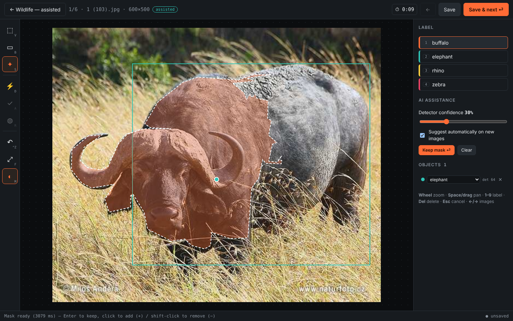

# Annotrix — AI-assisted image annotation

A web app that makes drawing bounding boxes and masks faster by putting computer-vision models
inside the labelling loop. Built from scratch for the *AI Vision* module (SRH Hochschule Heidelberg,
Prof. Dr.-Ing. Binh Vu) — no existing annotation tool is forked or wrapped.

**AI assistance, integrated in the editor**

| Feature | Model | What it saves the user |
|---|---|---|
| **Auto-suggest** — boxes with labels appear when an image opens; accept all with `A`, fix the rest | YOLO11 (Ultralytics), COCO-pretrained or fine-tuned | Drawing every box by hand |
| **Smart segment** — click an object (shift-click = background) or drag a rough box → precise mask | MobileSAM (CPU) or SAM 2.1 (GPU) | Tracing outlines point by point |
| **Fit mask to box** — `R` turns any selected box into a mask and tightens the box | same | Getting pixel-tight boxes |
| **Type any label** — labels the trained detector knows use it; any other label (e.g. `car, person, backpack`) is detected zero-shot from its name | YOLOE (open-vocabulary, MobileCLIP text encoder) | Being limited to the detector's trained classes |
| **Batch pre-label** — one button runs the detector over all unfinished images in the background; images then open with suggestions already in place | YOLO11 | Waiting for the model on every image |
| **Image enhancement** — brightness, contrast and auto-contrast (histogram equalization, `E`) for dark or hazy photos; display only, the models see the original | — (image processing) | Missing animals in shadow or at dusk |

Plus: projects with label sets, drag-and-drop upload, zoom/pan, move/resize, relabel with `1–9`,
undo, keyboard-first workflow, export to **COCO JSON**, **YOLO** and **YOLO-seg** (images included),
and a built-in **effort log** (active time and edit counts per image) used for the manual-vs-assisted evaluation.



**Links:** [Fine-tuned detector on Hugging Face](https://huggingface.co/AnishGaware10/annotrix-wildlife-yolo11n) · [Dataset annotated with Annotrix (COCO, 100 images)](https://huggingface.co/datasets/AnishGaware10/annotrix-wildlife-dataset)

---

## Run it — one command

```bash
docker compose up --build
```

Open <http://localhost:8000>. Models download on first use into `./data/weights`
(≈ 60 MB; the first AI call takes a few seconds longer).

**NVIDIA GPU** (needs the NVIDIA Container Toolkit; uses CUDA PyTorch and SAM 2.1-B):

```bash
docker compose -f docker-compose.yml -f docker-compose.gpu.yml up --build
```

**Choose models** with environment variables (or a `.env` file next to `docker-compose.yml`):

| Variable | Default | Examples |
|---|---|---|
| `LA_DETECTOR` | `yolo11s.pt` | `yolo11n.pt`, `wildlife-yolo11s.pt` (fine-tuned, in `data/weights/`) |
| `LA_SEGMENTER` | `mobile_sam.pt` | `sam2.1_t.pt`, `sam2.1_b.pt` |
| `LA_OPEN_VOCAB` | `yoloe-11s-seg.pt` | `""` to disable open-vocabulary labels (first use downloads a ~600 MB text encoder) |
| `LA_DEVICE` | `auto` | `cpu`, `cuda:0` |

### Without Docker (development)

```bash
# backend (Python 3.10+)
cd backend
pip install torch torchvision && pip install -r requirements.txt
uvicorn app.main:app --reload            # API on :8000

# frontend, in a second terminal (Node 20+)
cd frontend && npm install && npm run dev   # UI on :5173, proxies /api to :8000
```

Tests: `cd backend && pytest -q` (add `-m "not models"` to skip the tests that load the models).

---

## Using it

1. **Create a project** with a label list (e.g. `buffalo, elephant, rhino, zebra`). Mode `assisted` shows the AI tools; `manual` hides them (baseline for the study).
2. **Upload** images by drag and drop.
3. **Annotate.** Suggestions appear dashed. `A` accepts all, double-click accepts one, `Del` rejects. `S` = smart segment, `B` = draw box, `V` = select/move/resize, `1–9` = label, `R` = fit mask to box, `Enter` = save & next.
4. **Export** COCO / YOLO / YOLO-seg as a zip with the images.

| Key | Action | Key | Action |
|---|---|---|---|
| `V` / `B` / `S` | select / box / smart segment | `D` | run detector again |
| `A` | accept all suggestions | `R` | fit mask to selected box |
| `1`–`9` | set label (of selection) | `Del` | delete selection |
| `Enter` | keep mask / save & next | `←` `→` | previous / next image |
| `Ctrl+Z` | undo | `F` / `M` | fit view / toggle masks |
| wheel / space-drag | zoom / pan | `Esc` | cancel |

---

## Reproducing the evaluation

```bash
pip install -r requirements-eval.txt
python scripts/prepare_data.py                       # African Wildlife + COCO128-seg, study sets A/B
python eval/eval_detector.py --weights yolo11s.pt    # mAP, simulated edit counts, failure gallery
python eval/eval_segmenter.py                        # click-to-segment mIoU / NoC@85
python scripts/finetune.py --device 0                # fine-tune on a GPU (or notebooks/finetune_gpu.ipynb)
python eval/eval_detector.py --weights yolo11s.pt data/weights/wildlife-yolo11s.pt
python eval/effort.py --manual "Study manual" --assisted "Study assisted"   # after the user study
python eval/study_quality.py eval/results/effort/study_assisted_setB_coco.zip --split test   # label quality of a study export
```

Results are written to `eval/results/`. The protocol is in [docs/EVALUATION.md](docs/EVALUATION.md).

Detector results (CPU, African Wildlife test split, 227 images / 375 objects):

| detector | mAP@0.5 | mAP@0.5:0.95 | AP50 buffalo | AP50 elephant | AP50 rhino | AP50 zebra |
|---|---|---|---|---|---|---|
| yolo11s.pt (COCO) | 0.443 | 0.381 | 0.000 | 0.784 | 0.000 | 0.989 |
| yoloe-11s-seg.pt (zero-shot, prompted with the 4 names) | 0.504 | 0.410 | 0.340 | 0.707 | 0.007 | 0.962 |
| wildlife-yolo11n-cpu.pt (fine-tuned, 12 epochs on CPU) | **0.955** | **0.797** | 0.959 | 0.966 | 0.950 | 0.945 |

COCO has no buffalo or rhino class, which motivates fine-tuning. With the fine-tuned detector, 93% of test animals get a correct suggestion and only 23 of 375 boxes must be drawn by hand (92 with the stock model).

To use the fine-tuned detector, put the weights in `data/weights/` and create a `.env` file next to `docker-compose.yml` containing `LA_DETECTOR=wildlife-yolo11n-cpu.pt`.

---

## Architecture

```
browser (React + Konva canvas)
   │  REST / JSON
FastAPI ── SQLite (projects, images, annotations, work sessions)
   │
   ├── Detector  : Ultralytics YOLO11  (loaded once, GPU if available)
   └── Segmenter : MobileSAM / SAM 2.1 (image embedding cached per image)
```

`backend/app/ml.py` is the only place models are called; the evaluation scripts import the same
code, so the numbers in the report measure exactly what the app runs.

| Path | Contents |
|---|---|
| `backend/app/` | API (`main.py`), models (`ml.py`), DB (`db.py`), exporters (`export.py`) |
| `frontend/src/` | React UI; the editor is `pages/Annotator.tsx` |
| `eval/` | evaluation scripts; results in `eval/results/` |
| `scripts/` | data preparation and fine-tuning |
| `notebooks/` | GPU fine-tuning notebook |

## References

Models, libraries and datasets used are cited in [docs/REFERENCES.md](docs/REFERENCES.md).
Ultralytics (YOLO, SAM wrappers) is AGPL-3.0; this repository is therefore licensed under AGPL-3.0 (see `LICENSE`).
